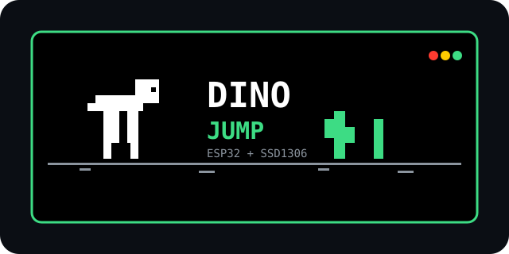

# ESP32_Dinojump



Chrome T-Rex runner บน **ESP32 + OLED SSD1306 128x64 (I2C 0x3C)** + ปุ่มเดียว + buzzer. มีเมนู START / RECORD / INFO และเซฟคะแนนสูงสุดลง flash.

## Demo

- `START` — เริ่มเกม กระโดดหลบกระบองเพชร + นก, เก็บหัวใจเพิ่มชีวิต
- `RECORD` — ดู `HI` / `LAST` (จำค่าข้ามรีบูตด้วย Preferences/NVS)
- `INFO` — ดูวิธีกดปุ่ม + สเปกจอ

## Hardware

| อุปกรณ์ | ต่อขา |
|---|---|
| OLED SSD1306 SDA | GPIO21 |
| OLED SSD1306 SCL | GPIO22 |
| OLED VCC / GND | 3V3 / GND |
| ปุ่มกด | GPIO18 <-> GND (`INPUT_PULLUP`, กด = LOW) |
| Buzzer (+) | GPIO12 (ไม่ต่อก็ได้) |

> จอต้องเป็น SSD1306 0.96" address `0x3C`. ถ้าเป็น SH1106 1.3" ให้ comment `#define LCD_SSD1306` ใน `t-rex-duino.h` กลับ

## Controls

| หน้า | ปุ่ม |
|---|---|
| Menu | กดสั้น 1 ครั้ง = เลื่อน, กดค้าง ~0.5s / เบิ้ล = เลือก |
| RECORD / INFO | กดอะไรก็ได้ = กลับเมนู |
| ในเกม | กดค้าง = กระโดด (`trex.jump()`), ปล่อย = ตก |
| Game Over | กดสั้น / กดค้าง = กลับเมนู (คะแนนเซฟอัตโนมัติ) |

## Build & Flash

1. เปิด `trex_esp32_pushbutton.ino` ใน Arduino IDE
2. เลือกบอร์ด ESP32 (เช่น ESP32 Dev Module), `Upload Speed 921600`
3. ไม่ต้องลง lib OLED — driver I2C เขียนเองใน `TRexCore.h` (clock 400kHz, ส่งทีละ 32 byte กัน `Wire` overflow)
4. เปิด Serial 115200 ดู log ได้

ไฟล์ทดสอบจอแยก (ไม่ต้องลง lib):

```cpp
// oled_test — ดูโค้ดเต็มในแชท
Wire.begin(21, 22);
Wire.setClock(100000); // scan หา 0x3C
Wire.setClock(400000); // init SSD1306 + เทสขาว/ดำ/ตาราง
```

## Project structure

```
trex_esp32_pushbutton.ino  — setup/loop, กำหนดขา SDA/SCL/BTN/BUZZER
t-rex-duino.h              — เสียง, ปุ่ม (debounce/multi-click/long-press),
                             menu START/RECORD/INFO, gameLoop, ฟอนต์ 5x7
TRexCore.h                 — สไปรต์เกม, engine, driver SSD1306/SH1106 I2C
logo.svg                   — โลโก้โปรเจกต์
```

## Config ที่น่าแก้

- `t-rex-duino.h: #define LCD_SSD1306` — เปิด = SSD1306 / ปิด = SH1106
- `TRexCore.h: SH1106_I2C_SCL_CLOCK 400000UL` — จอเอ๋อให้ลดเหลือ `100000UL`
- `GAME_BUTTON_PIN / BUZZER_PIN` ใน `.ino`
- `TARGET_FPS_START/MAX`, `LIVES_START/MAX` ใน `t-rex-duino.h`
- ล้างคะแนน: `dinoPrefs.clear()` หรือแฟลชแบบ erase flash

## Troubleshooting จอดำ

1. รัน I2C scanner ต้องเจอ `0x3C` ถ้าไม่เจอ = สาย/ไฟ (สลับ SDA/SCL บ่อยสุด, VCC ต้อง 3V3)
2. เจอ `0x3C` แต่ดำ = ผิด driver (SH1106 vs SSD1306) หรือ clock สูงไป ลอง `100kHz`
3. ขึ้น splash แต่ภาพเลื่อน = addressing mode ผิด ต้องเป็น Page mode (`0x20,0x02`)
4. GPIO12 เป็น strapping pin ถ้าบูตไม่ขึ้นให้ถอด buzzer แล้วลองใหม่

## Credit

- Base game: [AlexIII/t-rex-duino](https://github.com/AlexIII/t-rex-duino) (MIT)
- ESP32 + SSD1306 port, menu/record, I2C chunk fix: this repo
